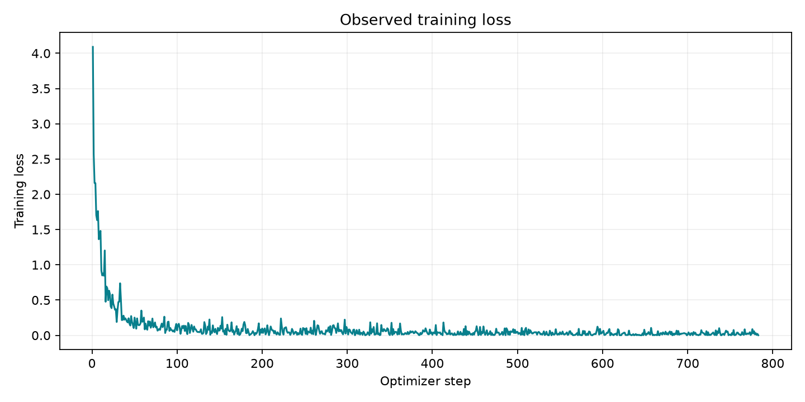

# MediFlow VLM 4개 영역 홀드아웃 평가

2026년 11월 28일 · 최종 저장 어댑터 · Qwen3.5-2B

로컬 GPU에서 학습과 검증 자료에 포함되지 않은 총 312장에 대해 추론을 실행했다.

| 영역 | 평가 후보 | 평가 | 기준 라벨 일치 | 클래스 응답 | 기존 분류기 일치 | 추론 오류 |
| --- | ---: | ---: | ---: | ---: | ---: | ---: |
| 안구 | 32 | 32 | 기준 라벨 없음 | 32/32 | 18/32 (56.2%) | 0 |
| 두피 | 1,252 | 150 | 93/150 (62.0%) | 150/150 | 97/150 (64.7%) | 0 |
| 얼굴 | 400 | 50 | 42/50 (84.0%) | 50/50 | 42/50 (84.0%) | 0 |
| 피부 | 700 | 80 | 78/80 (97.5%) | 80/80 | 78/80 (97.5%) | 0 |

정확도 분모는 평가에 들어간 전체 사진이다. 설정된 클래스 문자열과 응답이 정확히 일치할 때만 그 클래스로 집계했다.
기존 분류기 일치는 동일 사진에 대한 기존 라벨링 모델과 VLM의 응답 일치율이다.

## 두피

기준 라벨은 원본 두피 데이터의 테스트 분할 매니페스트를 사용했다. 자료에 있는 5개 클래스에서 각각 30장을 선택했다.
원본 테스트 분할에 양호 기준 사진이 없어 정상 두피의 분류 성능은 측정하지 못했다.

| 기준 클래스 | 표본 | VLM 일치 | 일치율 | 기존 분류기 일치 |
| --- | ---: | ---: | ---: | ---: |
| 모낭사이홍반 | 30 | 20 | 66.7% | 22 |
| 미세각질 | 30 | 19 | 63.3% | 24 |
| 비듬 | 30 | 12 | 40.0% | 17 |
| 탈모 | 30 | 18 | 60.0% | 24 |
| 피지과다 | 30 | 24 | 80.0% | 24 |
| 양호 | 0 | 0 | — | 0 |

가장 많이 나온 오분류는 비듬 → 미세각질 10장, 비듬 → 피지과다 8장, 탈모 → 피지과다 5장, 모낭사이홍반 → 탈모 5장, 모낭사이홍반 → 미세각질 5장이었다.

동일 표본의 기존 분류기는 기준 라벨과 111/150장 (74.0%) 일치했다.

## 얼굴

얼굴 테스트의 기준 인덱스와 선택 사진의 원본 아카이브 바이트를 대조했다. [얼굴 PMG 테스트 기준 CSV](https://github.com/Phjrab/mediflow-datasets/blob/d52bd95e4b6417ad39aa4550eaaf257dd40d29ed/results/web_skin/candidates/public_candidate_v2_pmg_b0_256_ce_20260922_235840_093d10de/final_test_predictions.csv)

| 기준 클래스 | 표본 | VLM 일치 | 일치율 | 기존 분류기 일치 |
| --- | ---: | ---: | ---: | ---: |
| 건선 | 10 | 8 | 80.0% | 8 |
| 아토피 | 10 | 7 | 70.0% | 9 |
| 여드름 | 10 | 9 | 90.0% | 9 |
| 정상 | 10 | 10 | 100.0% | 10 |
| 주사 | 10 | 8 | 80.0% | 10 |

동일 표본의 기존 분류기는 기준 라벨과 46/50장 (92.0%) 일치했다.

## 피부

피부 병변 근접 사진의 원본 테스트 분할 매니페스트를 사용했다. 피부 분류 체계는 병변 10개로 구성된다.

| 기준 클래스 | 표본 | VLM 일치 | 일치율 | 기존 분류기 일치 |
| --- | ---: | ---: | ---: | ---: |
| 광선각화증 | 8 | 7 | 87.5% | 8 |
| 기저세포암 | 8 | 7 | 87.5% | 7 |
| 보웬병 | 8 | 8 | 100.0% | 8 |
| 사마귀 | 8 | 8 | 100.0% | 7 |
| 지루각화증 | 8 | 8 | 100.0% | 8 |
| 편평세포암 | 8 | 8 | 100.0% | 8 |
| 표피낭종 | 8 | 8 | 100.0% | 8 |
| 피부섬유종 | 8 | 8 | 100.0% | 8 |
| 혈관종 | 8 | 8 | 100.0% | 8 |
| 흑색점 | 8 | 8 | 100.0% | 8 |

동일 표본의 기존 분류기는 기준 라벨과 78/80장 (97.5%) 일치했다.

## 안구

외안부 입력 조건을 충족한 미사용 사진 32장을 모두 평가했다. 이 사진들은 자동 라벨 채택 임계값을 통과하지 못했다.
독립 기준 라벨이 없어 보고한 기존 분류기와의 일치율로 정확도를 판단할 수 없다. 안저 사진은 평가에서 제외했다.

| VLM 응답 | 사진 수 |
| --- | ---: |
| 결막염 (Conjunctivitis) | 5 |
| 다래끼 (Eyelid) | 7 |
| 백내장 (Cataract) | 8 |
| 일반 (Normal) | 0 |
| 포도막염 (Uveitis) | 12 |
| 클래스 목록 밖 응답 | 0 |
| 추론 오류 | 0 |

## 학습과 저장

이전 VQA 어댑터를 이어서 783/783 스텝 학습했으며, 최종 어댑터를 저장하고 별도 GPU 프로세스에서 재로딩을 확인했다.
마지막 기록의 학습 손실은 0.001554였고, 자동 라벨 검증 표본 32장의 최저 검증 손실은 0.032739였다.

| 영역 | 학습에 포함 | 검증에 포함 | 자동 라벨 임계값 미달 | 원본 테스트 분할 |
| --- | ---: | ---: | ---: | ---: |
| 안구 | 1,895 | 482 | 32 | 0 |
| 두피 | 1,044 | 133 | 10,107 | 1,252 |
| 얼굴 | 3,553 | 458 | 89 | 400 |
| 피부 | 6,035 | 818 | 1,396 | 700 |

## 평가 조건과 한계

- 이번 VLM과 이전 VQA 어댑터의 고정 학습·검증 목록을 대조해 확인 가능한 중복을 제외했다. 이번 목록은 사진 ID, 파일 해시, 디코딩 픽셀 해시, 중복 그룹을 확인했고 이전 목록은 보존된 원본 파일 해시를 대조했다.
- 두피·얼굴·피부는 클래스별 고정 수량을 결과 확인 전에 선택했다. 원본 데이터의 클래스 비율, 사람 단위 중복, 별도 촬영 환경에서의 성능을 이 표본으로 추정할 수 없다.
- 두피·얼굴·피부의 기준은 데이터셋 라벨이다. 사진 분류 결과는 임상적 정확도나 진단 성능을 입증하지 않는다.
- 기존 분류기 수치는 동일 표본에서의 비교다. 이전 VQA 어댑터의 추론은 수행하지 않아 이번 추가 학습으로 얼마나 개선되었는지는 알 수 없다.

[집계 데이터와 혼동행렬](metrics.json) · [학습 스텝별 손실](training_loss.csv)

